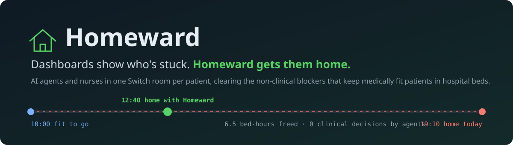
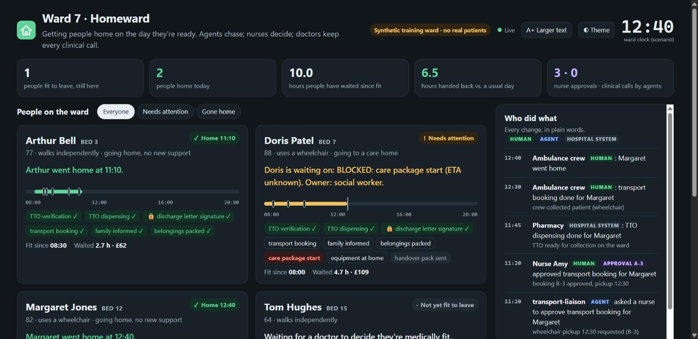
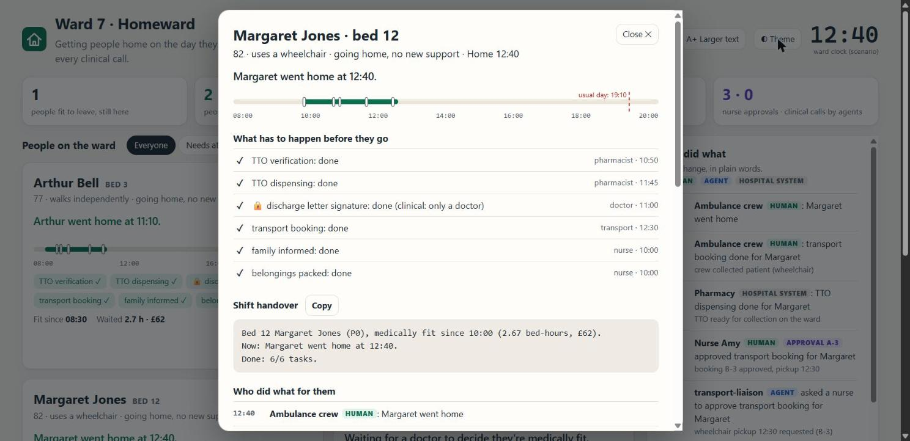
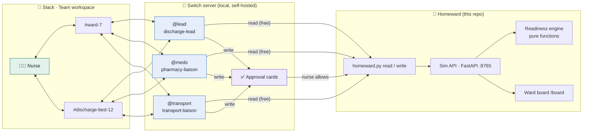
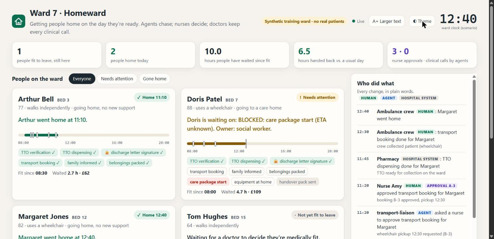

<div align="center">



<br />

[](https://github.com/BUTTERFINGERS7498/SWITCHAI/actions/workflows/ci.yml)    

    

**AI agents and the people on a hospital ward share one [Switch](https://github.com/sandbox-quantum/switch) room per patient. The agents chase medicines, transport and paperwork; a nurse approves every outward action; clinicians keep every clinical decision.**

[Quick start](#-quick-start) · [Margaret's day](#-margarets-day) · [Why Switch](#-why-it-needs-switch-the-unplug-test) · [How it works](#-how-it-works) · [Safety](#-safety-by-construction) · [Docs](docs/)

### 🎥 Watch the demo

**[Demo video: link to be added]** <!-- TODO: paste the video URL before submitting -->

<sub>Built during the <b>Flip the Switch</b> hackathon (WeMakeDevs × DevTools Academy × Switch), Track 01: Best Business Workflow.</sub>

</div>

<br />

<p align="center">
  
</p>
<p align="center"><sub>The ward board at 12:40 after the demo day. Everyone on it is invented.</sub></p>

---

## 💡 Why Homeward?

Every day in England, about **13,000 people who are medically fit to go home are still in a hospital bed**, roughly **1 in 10 beds**, at about **£562 per bed-day**. Most of that delay isn't medical. It's coordination:

- discharge medicines (**TTO**, "to take out") are requested late,
- transport is booked late, or for a time when the medicines aren't ready,
- the doctor's letter waits for a signature,
- and the chasing happens in WhatsApp and phone calls where **nobody owns it**.

Tools like discharge dashboards *show* who is stuck. **Homeward works the queue**, inside the team chat where the coordination already happens.

> *Figures are NHS England delayed-discharge statistics as summarised in our research dossier. Homeward does not create care-home beds or social-care capacity; it attacks the same-day, hours-long delays.*

---

## ✨ Highlights

<table>
  <tr>
    <td width="50%" valign="top">
      <h3>🏠 A room per person</h3>
      Each medically fit patient gets a Switch room (<code>#discharge-bed-12</code>) with its own instructions, jobs and checklist document, linked to the ward hub (<code>#ward-7</code>).
    </td>
    <td width="50%" valign="top">
      <h3>✅ A nurse's yes on every outward action</h3>
      Agents read freely, but every change raises a Switch approval card (Allow once / Decline). Bookings record the approving nurse in the ledger.
    </td>
  </tr>
  <tr>
    <td valign="top">
      <h3>🔒 Non-clinical by construction</h3>
      Fitness decisions, medicines and the discharge letter are refused by the engine (<code>HUMAN_ONLY</code>), and the agents refused them in live testing too.
    </td>
    <td valign="top">
      <h3>🚑 Transport timed to reality</h3>
      Pickup must be at least 20 minutes after both the medicines and the letter are ready, so the ambulance never arrives before the patient can leave.
    </td>
  </tr>
  <tr>
    <td valign="top">
      <h3>🔁 Recovers from the curveball</h3>
      The provider cancels at 11:20; the board turns amber; <code>@transport</code> finds the next safe slot and asks the nurse again.
    </td>
    <td valign="top">
      <h3>🧾 One honest answer</h3>
      "Margaret is waiting on: TTO dispensing (ETA 11:45). Owner: pharmacist." A one-message shift handover, and a plain-words ledger of who did what.
    </td>
  </tr>
</table>

---

## 🕙 Margaret's day

Margaret Jones, 82, uses a wheelchair, and is going home with no new support. She is declared medically fit at **10:00**.

<p align="center">
  
</p>

| Scenario clock | What happens | Who |
|---|---|---|
| 10:00 | Doctor declares Margaret fit in the hospital system (EPR) | Dr Raj (simulated EPR) |
| 10:00 | `@lead` opens the plan; `@meds` sends the TTO request | agents · nurse approves the card |
| 10:05 | `@transport` books a wheelchair for **12:15** (meds ready 11:45 + 20 min) | agent proposes · **nurse approves** |
| 10:05 | Family told and belongings packed, recorded as "reported by nurse-amy" | `@lead` · nurse approves |
| 11:00 | Letter signed in the EPR | Dr Raj (simulated EPR) |
| **11:20** | **Provider cancels the 12:15**; board turns amber | transport provider (simulated) |
| 11:20 | `@transport` rebooks **12:30**; nurse approves | agent · **nurse approves** |
| 11:30 | Night nurse: "`@lead` what's left for bed 12?" → one-message handover | `@lead` |
| **12:40** | **Margaret goes home**, not at 19:10 | crew (simulated) |

**Result (from `scenario margaret --auto`, asserted in the test suite):** home at **12:40 instead of 19:10**, **6.5 bed-hours freed** (about £152), **2 nurse approvals**, **6 agent actions**, **0 clinical actions by agents**.

<details>
<summary><b>What a real Slack run looked like</b></summary>

We ran the day live in Slack with three Claude Code agents connected through Switch: [`docs/TEST_RUN_LIVE.md`](docs/TEST_RUN_LIVE.md). Highlights: `@lead` handed off to `@meds` without being asked; every write raised an approval card; the agents refused to sign the letter, mark medicines dispensed, or declare an unfit patient fit, and the hospital ledger was unchanged afterwards. That run used earlier pharmacy timings, so Margaret left at 12:10.

</details>

---

## 🔌 Why it needs Switch (the unplug test)

Take Switch away and the agents can't see the ward, can't hand work to each other, and can't act with a nurse's approval. Homeward stops working.

| Switch feature | Where Homeward uses it | What breaks without it |
|---|---|---|
| **Rooms** (Slack channel ↔ Switch room) | `#ward-7` hub, `#discharge-bed-12` per patient | No shared place where nurses and agents see the same patient |
| **Room instructions** | [`switch/room-instructions.md`](switch/room-instructions.md): hard rules, roster, glossary | Agents join without the non-clinical rules or the ward roster |
| **Jobs (roles), exclusive and shared** | `@lead` (exclusive), `@meds`, `@transport` | People must know which agent does what; swapping an agent breaks every request |
| **Approval cards** (Allow once / Decline, approver recorded) | Every `homeward.py write`; transport bookings carry the approving nurse | Agents could act without a human's yes |
| **Who-can-instruct policy** | Agents take instructions only from the owner and their agents | Anyone in the channel could direct an agent |
| **Agent-to-agent addressing** | `@lead` hands off to `@meds` and `@transport` | A human has to relay every step |
| **Room documents** | `discharge-plan-bed-N` checklist, written and updated by `@lead` | No durable checklist in the room |
| **Linked rooms** | `#ward-7` ↔ `#discharge-bed-12` | The ward hub and patient rooms are islands |
| **Follow-ups in threads** | Replies continue a thread without re-tagging | Every message needs an `@mention` |
| **Multi-agent, any harness** | Three Claude Code sessions, managed by Switch Console | One agent per chat, no division of work |

---

## 🧭 How it works



- **The engine owns every state change.** Agents only propose; each write is validated against a task transition table, dependencies, the pickup rule, and who may do what.
- **Hospital systems are simulated and act on a scenario clock**: the doctor's EPR entries (fitness, letter), the pharmacy (verify 50 min, dispense 55 min), the transport provider and crew. Agents never act as those people.
- **Time is an input.** Every engine function takes `now`; the simulator owns one clock, which makes the day deterministic and testable.

<details>
<summary><b>The rules the engine enforces</b></summary>

| Rule | Error if broken |
|---|---|
| Only valid status changes (`pending → ready → in_progress …`) | `INVALID_TRANSITION` |
| A task can't start or finish before its dependencies | `DEPENDENCY_UNMET` |
| Clinical tasks (the discharge letter) can only be completed by a human doctor | `HUMAN_ONLY` |
| Only a doctor can declare someone medically fit | `HUMAN_ONLY` |
| A task waiting for approval can only be approved by a human; transport only by a nurse | `APPROVAL_REQUIRED` |
| A human in the wrong role can't complete someone else's task (a nurse may complete non-clinical ones) | `FORBIDDEN_ROLE` |
| Pickup ≥ max(medicines ready, letter ready) + 20 min | `PICKUP_TOO_EARLY` |
| Agents can't set pharmacy status or mark transport done | `FORBIDDEN_ROLE` / `APPROVAL_REQUIRED` |
| Targets: TTO verify 60 min, dispense 90 min, transport confirmed 30 min; nudge at 1× and 1.5×, escalate to the bed manager at 2× | ledger `nudge` / `escalation` |

</details>

---

## 🛡️ Safety by construction

- **Agents never make clinical decisions.** Enforced in code (above), stated in the room instructions, and observed live: asked to record a fitness decision under a doctor's name, `discharge-lead` refused.
- **Agents act as themselves.** Every agent write is `{"type":"agent","role":"coordinator"}`, and anything a person reported is attributed: `"reported by nurse-amy: daughter Sarah told 10:05"`. This came from the agent itself refusing to pose as a nurse.
- **Every outward action needs a person's yes**, through Switch's approval card.
- **Self-hosted.** Switch and Homeward run locally; no patient data leaves the machine. All data in this repo is synthetic.
- **The board renders agent-written text as text only**, never as HTML.

---

## 🚀 Quick start

Needs Python 3.12+. Built and run on Windows 11; CI runs the tests on Ubuntu and Windows (macOS untested). `make <cmd>` is a thin wrapper for macOS/Linux.

```bash
git clone https://github.com/BUTTERFINGERS7498/SWITCHAI.git
cd SWITCHAI
python scripts/homeward.py setup      # creates .venv, installs requirements
python scripts/homeward.py test       # 80 tests: contract, engine, API, CLI, scenario
python scripts/homeward.py demo       # simulator + board on http://127.0.0.1:8765
```

In a second terminal, see the whole day without Slack:

```bash
python scripts/homeward.py scenario margaret --auto
```

Then open **http://127.0.0.1:8765/board**. API docs are at `/docs`.

### Run it with Switch and Slack (the real demo)

1. Install [Switch Console](https://github.com/sandbox-quantum/switch/releases) and start a local server.
2. Connect Slack with [`switch/slack-app-manifest.json`](switch/slack-app-manifest.json) (Socket Mode, so no public URL is needed).
3. Follow [`switch/SETUP.md`](switch/SETUP.md): channels, three agents (**Directory must be this repo folder**), room instructions, jobs, links.
4. Keep `python scripts/homeward.py demo` running, then run the live day:

```bash
python scripts/homeward.py scenario margaret     # drives the clock and hospital events, pauses for Slack
```

---

## 🤖 The agents

| Agent (Switch) | Job | Does | Never |
|---|---|---|---|
| `discharge-lead` | `@lead` (exclusive) | Confirms fitness in the EPR, posts the plan, keeps the checklist document, hands off, answers "what's left?" | Declares fitness, signs the letter |
| `pharmacy-liaison` | `@meds` | Sends and tracks the TTO request, tells `@transport` the ready time | Changes medicines, sets TTO status |
| `transport-liaison` | `@transport` | Reads the earliest safe pickup, proposes a slot, books with a nurse's approval, rebooks on cancellation | Books before the meds and letter are ready, names an approver who didn't approve |

All three are Claude Code sessions run by Switch Console, with the role files in [`switch/roles/`](switch/roles/). Project permissions in [`.claude/settings.json`](.claude/settings.json) allow `homeward.py read` and require approval for `homeward.py write`.

<details>
<summary><b>Agent tools: the whole interface</b></summary>

```bash
python scripts/homeward.py read patients/12/blocker
python scripts/homeward.py read "transport/slots?vehicle=wheelchair&after=2026-11-07T12:05:00+00:00"
python scripts/homeward.py write POST patients/12/tto/request '{"actor":{"id":"pharmacy-liaison","role":"coordinator","type":"agent"}}'
```

Output starts with one human line ("Margaret is waiting on: …", "REJECTED HUMAN_ONLY: …", "Booking B-3 confirmed …"), then JSON. Exit codes: `0` ok, `1` rejected by Homeward, `2` usage, `3` simulator not running. Paths are written without a leading `/` (Git Bash on Windows rewrites `/x`; the CLI also undoes that).

</details>

<details>
<summary><b>Simulator API</b></summary>

| Method + path | Purpose |
|---|---|
| `GET /health` · `POST /reset` | status · reseed Ward 7 at 10:00 |
| `GET/POST /clock` | scenario clock (`now` or `advance_minutes`) |
| `GET /patients` · `GET /patients/{bed}` | the ward · one person |
| `POST /patients/{bed}/mffd` | declare medically fit (doctor only) |
| `GET /patients/{bed}/plan` · `/blocker` · `/handover` · `/ledger` | tasks · current blocker + cost · shift handover · audit |
| `PATCH /patients/{bed}/tasks/{id}` | validated task change, with `detail` for attribution |
| `GET /patients/{bed}/tto` · `POST …/tto/request` | pharmacy |
| `GET /patients/{bed}/transport/eligibility` · `GET /transport/slots` | vehicle, earliest pickup, free slots |
| `POST /patients/{bed}/transport/bookings` (+ `/confirm`, `/decline`) | book, with the approving nurse |
| `POST /events` | `transport_cancelled`, `letter_signed`, `tto_delayed` (optionally scheduled with `at`) |
| `GET /board/ward` · `GET /board` | board data · board page |

Errors are always `{"error": {"code", "message", "details"}}`. Full contract: [`docs/ARCHITECTURE.md`](docs/ARCHITECTURE.md).

</details>

---

## 🖥️ The ward board

<p align="center"></p>

Person-first, not bed-first: "Margaret, 82, uses a wheelchair, going home with no new support". Each card has a **day strip** from fit-to-go to home, with a dashed marker for when they would usually have left. Select a person for their whole day: tasks in plain words, the shift handover (with Copy), and their own ledger. There are filters, a **larger-text** mode for projectors, light/dark themes, keyboard navigation, status shown with words and icons as well as colour, and reduced-motion support. Approvals stay in Slack, on purpose.

---

## 🗂️ Project structure

```
homeward/
  contracts.py        shared types, transition table, rules (contract v1.2.0)
  engine.py           readiness engine: pure functions, `now` is always an input
  scenario.py         the demo day: live (pauses for Slack) or --auto
  sim/                FastAPI simulator: state.py, seed.py (Ward 7), app.py, static/board.html
scripts/homeward.py   one cross-platform entrypoint: setup · test · demo · scenario · read · write
switch/               Switch setup: SETUP.md, room-instructions.md, roles/*.md, slack-app-manifest.json
.claude/settings.json agent permissions: read allowed, write asks
tests/                80 tests (contract 9, engine 34, API 25, CLI 9, scenario 3)
docs/                 ARCHITECTURE, DECISIONS (34 recorded), SPIKE, TEST_RUN_LIVE, IMPLEMENTATION_PLAN
```

| Setting | Default | Purpose |
|---|---|---|
| `HOMEWARD_URL` | `http://127.0.0.1:8765` | where the CLI and scenario runner find the simulator |
| `HOMEWARD_PORT` | `8765` | port for `homeward.py demo` |

---

## ⚠️ Honest limitations

- **Synthetic hospital.** The EPR, pharmacy and transport are simulated; there are no real NHS integrations.
- **The actor on an API write is declared by the caller.** In the Switch deployment the real approver is whoever clicked the approval card, and Switch records it; the hospital ledger takes the nurse from the room roster.
- **Agents act when addressed.** Nothing pushes simulator events into Slack yet, so after the 11:20 cancellation a nurse prompts `@transport` (the board shows the amber blocker).
- **One ward, one approving human** in the demo. Switch links in Slack resolve only on the machine running the server (local, self-hosted).
- **Capacity isn't created.** Days-long delays waiting for care-home beds or care packages are out of scope; Doris (bed 7) stays blocked on purpose.

---

## 🗺️ Roadmap

- [x] Readiness engine with clinical / approval / timing rules and 34 tests
- [x] Simulated hospital with scenario clock and curveball events
- [x] Three Claude Code agents in Switch with jobs, approvals and room documents
- [x] Live end-to-end run in Slack, plus a deterministic `--auto` scenario
- [x] Person-first ward board
- [ ] Push simulator events into the room (a deterministic "ward clerk" agent over the Switch agent protocol)
- [ ] "Expected fit tomorrow" pre-staging of TTO and provisional transport
- [ ] Care-handover agent for pathways 1–3
- [ ] Mixed-vendor rooms (Claude Code + Codex)

---

## 🤝 Contributing

Issues and pull requests are welcome. Run `python scripts/homeward.py test` before opening a PR; decisions that change the contract go in [`docs/DECISIONS.md`](docs/DECISIONS.md). Please keep everything synthetic: no real patient data, ever.

## 📖 Glossary

**MFFD**: medically fit for discharge · **TTO**: "to take out", discharge medicines · **Pathway 0–3**: home / home with support / rehab bed / care home · **EPR**: electronic patient record · **Bed-day**: one bed for one day (£562, £23.42 per hour)

## 📄 License

**[License: to be chosen]** <!-- TODO: add a LICENSE file (e.g. MIT) and update this section and the badge -->

## 🙌 Team & acknowledgements

- **[Team / author names: to be confirmed]** <!-- TODO -->
- Built on [Switch](https://github.com/sandbox-quantum/switch) by SandboxAQ, for the Flip the Switch hackathon by WeMakeDevs and DevTools Academy.
- Problem research: the team's Flip the Switch problem & strategy dossier.
